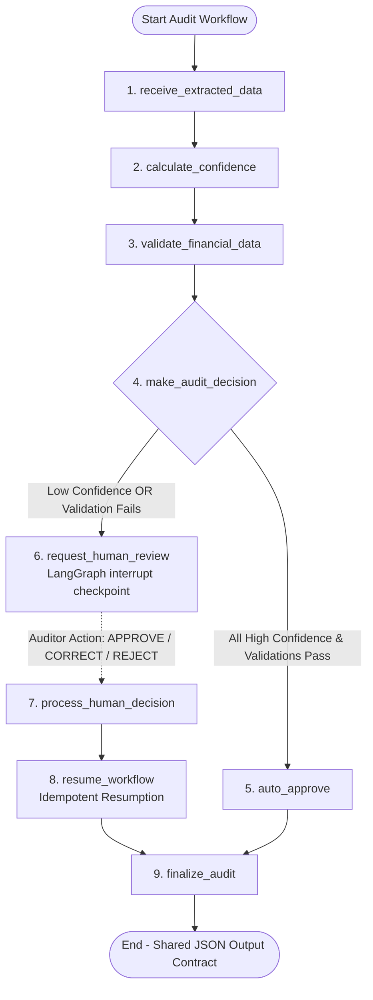

# FinAudit AI — Agentic Financial Filing Auditor (MINEARENA 1.0 PS-01)

**FinForge Platform**  
**Hackathon:** MINEARENA 1.0 PS-01  
**Module Focus:** **TASK 2 – AGENTIC AI, CONFIDENCE SCORING & FINANCIAL VALIDATION**  
**Author / Member 2:** Megha (`Megha12-cell`)  
**Branch:** `megha`  
**Shared Repositories:** 
- Primary: [https://github.com/divya182307-dot/FinForge](https://github.com/divya182307-dot/FinForge)
- Member 2 GitHub: [https://github.com/Megha12-cell](https://github.com/Megha12-cell)

---

## 1. Executive Summary & Objective

**FinAudit AI** is an enterprise-grade agentic financial filing audit engine designed for autonomous SEC EDGAR 10-K analysis with strictly governed **Human-in-the-Loop (HITL)** architecture.

The central innovation of this project is not merely extracting financial figures: **it is knowing when the AI should act independently and when it must stop and ask a human.**

### Member 2 Responsibilities (Task 2):
1. **Intelligent Financial Auditing Engine:** Receive structured JSON financial metrics from Member 1 without hardcoded company dependencies.
2. **Explainable Confidence Scoring Engine:** Deterministic, multi-factor scoring (0–100) based on source evidence, extraction reliability, canonical GAAP tag recognition, unit/period consistency, and SEC XBRL agreement.
3. **Financial Validation Engine:**
   - **Accounting Equation:** $\text{Total Assets} = \text{Total Liabilities} + \text{Shareholders' Equity}$ (with configurable unit normalization & tolerance).
   - **Segment Validation:** Operating/geographic segment sum compared against consolidated total (`NOT_APPLICABLE` when segment data is unavailable).
   - **Year-on-Year (YoY) Anomaly Analysis:** Dynamic percentage change detection with alerts for variations $> 30\%$.
4. **Automated Decision Engine:** Strict rules routing audits to `AUTO_APPROVED` or `NEEDS_HUMAN_REVIEW` (a failed validation can never be approved merely because confidence is high).
5. **9-Node LangGraph StateGraph Workflow with Interrupts & Persistence:**
   - Implements LangGraph `interrupt()` for human escalation.
   - Persistent checkpoint saving & recovery using `SqliteSaver` / `MemorySaver` with stable thread IDs.
   - Supports human review actions: `APPROVE`, `CORRECT` (preserves original value), and `REJECT` (preserves rejection justification).
   - Idempotent execution preventing duplicate actions after resumption.
6. **Shared JSON Output Contract:** Standardized output format aligning Member 1 extraction, Member 2 validation, and Member 3 dashboard persistence.

---

## 2. 9-Node LangGraph Workflow Architecture



### The 9 Nodes in Detail:
1. `receive_extracted_data`: Receives structured JSON financial metrics from Member 1, normalizes fields (e.g. `metric_name` $\to$ `metric`), and registers idempotency keys.
2. `calculate_confidence`: Computes explainable scores (0–100) across 5 financial evaluation dimensions.
3. `validate_financial_data`: Executes Accounting Equation, Segment Integrity, and YoY variance checks.
4. `make_audit_decision`: Evaluates business routing rules; directs to `auto_approve` or `request_human_review`.
5. `auto_approve`: Generates auto-approval records for trusted metrics.
6. `request_human_review`: Automatically triggers LangGraph `interrupt(...)`, saves thread checkpoint, and awaits auditor input.
7. `process_human_decision`: Resolves human reviewer payload (`APPROVE`, `CORRECT` with original value preserved, or `REJECT` with reason).
8. `resume_workflow`: Verifies checkpoint restoration without duplicate extraction or side effects.
9. `finalize_audit`: Packages final shared JSON output contract and completes audit.

---

## 3. Project Structure (Task 2 Modules)

```
finforge/
├── workflow_state.py             # Pydantic schemas, TypedDict state, & shared contracts
├── confidence_engine.py          # Multi-factor explainable confidence scoring (0-100)
├── validation_engine.py          # Accounting equation, Segment check, & YoY anomaly engine
├── decision_engine.py            # Automated approval vs. human review routing rules
├── audit_graph.py                # 9-node LangGraph StateGraph with interrupt & SqliteSaver
├── review_handler.py             # External API integration callable functions & controller
├── test_workflow.py              # Pytest test suite covering all 10 mandatory evaluation scenarios
├── sample_workflow_execution.py  # Interactive end-to-end demonstration script
├── backend/                      # Member 3 FastAPI service, database models, & seed data
├── frontend/                     # Member 3 Dark-Navy Fintech Dashboard
└── README.md                     # Complete documentation
```

---

## 4. Multi-Factor Confidence Scoring Engine

Confidence is calculated out of 100 points across five explainable criteria:

| Factor | Weight | Evaluation Criteria |
| :--- | :---: | :--- |
| **Source Evidence Availability** | 25 pts | Filing context, accession number, statement/Item 8 citations, and verbatim excerpts |
| **Extraction Method Reliability** | 25 pts | SEC XBRL audited instance (25 pts), Structured table parser (20 pts), LLM text inference (12 pts) |
| **Metric Identification** | 20 pts | Canonical US-GAAP / IFRS tag matching (`us-gaap:Assets`, `StockholdersEquity`, `Revenues`, etc.) |
| **Unit & Period Consistency** | 15 pts | Valid currency (`USD`, `EUR`), well-formed fiscal periods (`FY2026`, `Q3 2026`) |
| **SEC XBRL Agreement** | 15 pts | Corroboration against reported XBRL taxonomy facts |

### Configurable Thresholds:
- **High Confidence ($\ge 90$):** Eligible for auto-approval (if validations pass).
- **Medium Confidence ($70 - 89.9$):** Flagged for auditor verification.
- **Low Confidence ($< 70$):** Mandatory escalation for human review.

---

## 5. Mandatory Financial Validations

### A. Accounting Equation:
$$\text{Total Assets} = \text{Total Liabilities} + \text{Shareholders' Equity}$$
- Automatically normalizes units (e.g. Millions, Billions, Base USD).
- Configurable relative tolerance (0.5%) and absolute tolerance ($1M).
- If difference exceeds tolerance, fails validation and flags all three balance sheet metrics.

### B. Segment Validation:
$$\sum \text{Segment Values} == \text{Consolidated Metric Total}$$
- Verifies business and geographic segment reporting against consolidated total.
- **Rule:** If segment data is unavailable in the filing, marks status as `NOT_APPLICABLE` (never falsely marked as `PASSED`).

### C. Year-on-Year (YoY) Analysis:
$$\text{YoY \% Change} = \frac{\text{Current Value} - \text{Prior Value}}{|\text{Prior Value}|} \times 100$$
- Flags unusual swings exceeding configurable threshold ($> 30\%$).
- Generates detailed, human-readable explanations for every flagged variance.

---

## 6. Shared JSON Output Contract

### High-Confidence Auto-Approved Metric:
```json
{
  "metric": "Revenue",
  "value": 478834000000.0,
  "confidence": 100.0,
  "confidence_level": "HIGH",
  "validation_status": "PASSED",
  "decision": "AUTO_APPROVED",
  "review_required": false,
  "reason": "Confidence threshold met and validation passed",
  "source_evidence": "Filing 0000320193-26-000026 [us-gaap:RevenueFromContractWithCustomerExcludingAssessedTax]: Item 8 reported value '478,834' with scale=10^6"
}
```

### Flagged Metric Requiring Human Escalation:
```json
{
  "metric": "Total Liabilities",
  "confidence": 52.0,
  "validation_status": "FAILED",
  "decision": "NEEDS_HUMAN_REVIEW",
  "review_required": true,
  "reason": "Accounting equation mismatch",
  "source_evidence": "Original filing evidence"
}
```

### Metric Corrected by Human Auditor:
```json
{
  "metric": "Total Assets",
  "value": 404548000000.0,
  "confidence": 92.0,
  "confidence_level": "HIGH",
  "validation_status": "PASSED",
  "decision": "HUMAN_CORRECTED",
  "review_required": false,
  "reason": "Corrected by auditor cpa_sarah_connor: Corrected Total Assets from $550,000M to verified SEC Form 10-K value of $404,548M.",
  "source_evidence": "Balance sheet scan",
  "original_value": 550000000000.0,
  "corrected_value": 404548000000.0,
  "human_resolution": {
    "action": "CORRECT",
    "original_value": 550000000000.0,
    "corrected_value": 404548000000.0,
    "reviewer_id": "cpa_sarah_connor",
    "timestamp": "2026-11-12T09:22:25.277784+00:00"
  }
}
```

---

## 7. Official Integration Callable Functions

```python
from confidence_engine import calculate_confidence
from validation_engine import (
    validate_accounting_equation,
    validate_segments,
    analyze_year_on_year
)
from review_handler import (
    run_audit_workflow,
    submit_human_decision,
    resume_audit_workflow
)

# 1. Calculate Confidence
conf = calculate_confidence(metric_dict)

# 2. Financial Validations
acct_res = validate_accounting_equation(financial_data)
seg_res = validate_segments(financial_data)
yoy_res = analyze_year_on_year(financial_data)

# 3. Workflow Execution with LangGraph Interrupt
state = run_audit_workflow(audit_data)

# 4. Submit Review & Resume
resumed_state = submit_human_decision(
    audit_id=audit_id,
    decision={"action": "CORRECT", "corrected_value": 404548000000.0}
)
```

---

## 8. Verification & Test Suite

The test suite in `test_workflow.py` rigorously validates all **10 mandatory evaluation requirements**:

| # | Test Case | Description | Result |
| :-: | :--- | :--- | :-: |
| 1 | `test_1_high_confidence_auto_approval` | Clean Apple 10-K data routes to `AUTO_APPROVED` | **PASSED** |
| 2 | `test_2_low_confidence_escalation` | Metric score $< 70$ triggers interrupt and review queue | **PASSED** |
| 3 | `test_3_accounting_equation_failure` | Assets $\ne$ Liab + Equity escalates even if confidence is 100% | **PASSED** |
| 4 | `test_4_segment_mismatch` | Segment sum $\ne$ consolidated total escalates to review | **PASSED** |
| 5 | `test_5_unusual_yoy_variation` | Revenue swing $> 30\%$ triggers review warning | **PASSED** |
| 6 | `test_6_human_approval` | Auditor `APPROVE` action marks metric approved & resumes graph | **PASSED** |
| 7 | `test_7_human_correction` | Auditor `CORRECT` action stores corrected value, preserving original | **PASSED** |
| 8 | `test_8_human_rejection` | Auditor `REJECT` action marks metric rejected with reason | **PASSED** |
| 9 | `test_9_sqlite_checkpoint_pause_and_resume` | True disk-based SQLite checkpoint persistence & resumption | **PASSED** |
| 10 | `test_10_no_duplicate_actions_after_resumption` | Node idempotency guarantees zero duplicated side effects | **PASSED** |

### Running the Test Suite:
```powershell
python -m pytest test_workflow.py -v
```

### Running the Interactive Demonstration:
```powershell
python sample_workflow_execution.py
```

---

## 9. Official Problem Statement References
- **LangGraph Interrupts:** [https://docs.langchain.com/oss/python/langgraph/interrupts](https://docs.langchain.com/oss/python/langgraph/interrupts)
- **LangGraph Checkpointers:** [https://docs.langchain.com/oss/python/langgraph/checkpointers](https://docs.langchain.com/oss/python/langgraph/checkpointers)
